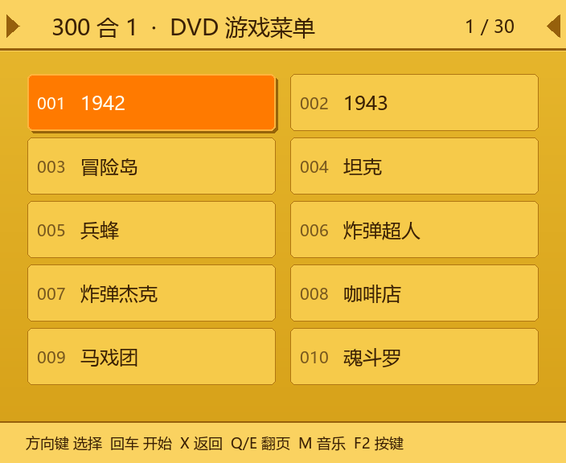
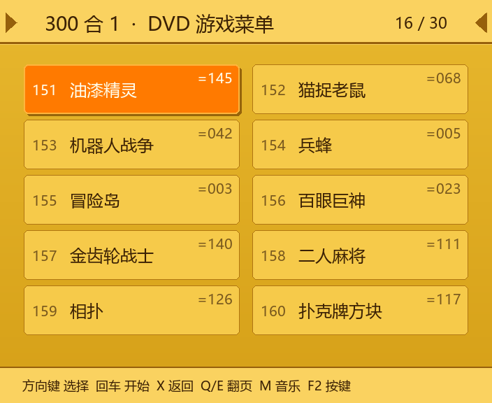
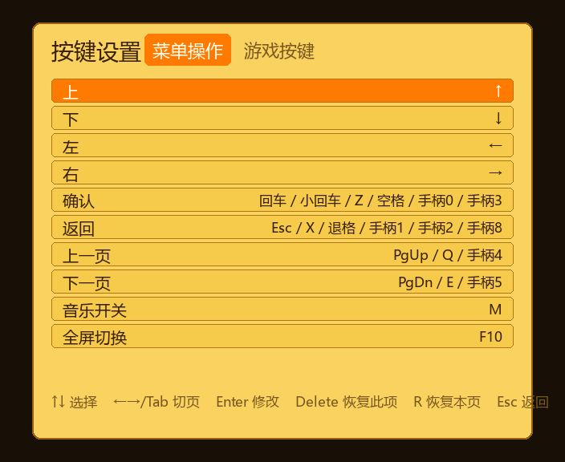

# retro-dvd-gameplay

<p align="center">
  <a href="README.md">English</a> · <a href="README.zh-CN.md">简体中文</a>
</p>

<p align="center">
  <a href="https://github.com/dncore/retro-dvd-gameplay/actions/workflows/tests.yml">
    
  </a>
</p>

<p align="center">
  <a href="https://github.com/dncore/retro-dvd-gameplay/releases/latest">
    <b>Download the portable Windows build</b>
  </a>
</p>

<p align="center">
  
</p>

A love letter to the 2005 Chinese **“300 合 1”** DVD-player NES disc: the mustard-yellow
menu, the slightly off-key background music, and the half second of disc seeking after
you press Start.

This is **not** a hardware emulator. It is a period-correct shell around a real NES core:
the disc's own layout and boot animation, a recreated menu, and an in-process libretro host.

## Features

- All **300 entries** in the disc's original `G001`–`G300` order (146 unique games after de-duplication)
- **Chinese menu names for all 300 slots**, transcribed from the original menu list (obvious
  typos corrected); the catalog keeps the English ROM titles as a fallback
- **DVD-style menu**: 10-row single column, 16 px SimSun, orange cursor bar, and the
  disc's per-page artwork behind it; keyboard and SDL gamepad both work
- Legacy **2×5 grid** available with `"menu_style": "grid"`
- The disc's **22-second boot animation** (`CDI_BUM.DAT`), extracted from your own image at runtime
- The disc's **background music**, looping in the menu
- **Built-in libretro host** (`rdvd/libretro.py`, `ctypes`): fceumm or Nestopia runs in-process,
  no RetroArch installation required; automatic save state on exit
- **Game audio** mixed through the same `pygame.mixer` as the menu music (16-bit stereo,
  linearly resampled when the core's rate differs from the mixer's)
- Optional fallback to an external emulator (RetroArch, FCEUX, Mesen, Nestopia)
- Headless renderer for exporting UI screenshots

## Screenshots

| Page 1 | Page 16 |
|---|---|
|  |  |

The `=NNN` badge marks an entry that points at the same ROM as an earlier number — the
original disc really did repeat games under different menu slots.

## Quick start (Windows)

```bat
git clone https://github.com/dncore/retro-dvd-gameplay.git
cd retro-dvd-gameplay
py -3 -m venv .venv
.venv\Scripts\activate
pip install -r requirements.txt

copy config.example.json config.json
notepad config.json
python run.py
```

Set `disc` to your own `300nes_disc v1.iso` and `roms` to your NES ROM directory.
Windows core DLLs (fceumm and Nestopia) are already in `cores/`.

**ffmpeg is optional but recommended.** It is used to turn the disc's intro and music
into playable media. Without it the game still runs; the boot animation and menu music
are skipped.

### Linux / macOS

```bash
python3 -m venv .venv && . .venv/bin/activate
pip install -r requirements.txt
cp config.example.json config.json
# Put a libretro NES core in cores/ (the repo ships Windows DLLs only):
#   fceumm_libretro.so / fceumm_libretro.dylib
python run.py
```

## Building a Windows executable

```powershell
powershell -ExecutionPolicy Bypass -File packaging\build.ps1 -InstallTools -Clean
powershell -ExecutionPolicy Bypass -File packaging\smoke_test.ps1
```

The portable bundle lands in `dist\retro-dvd-gameplay\`. `config.json` is copied next to
the exe, while `data/` and `cores/` are bundled under `_internal\`. PyInstaller and Pillow
are dev-only dependencies and are not needed to run from source.

```bash
pip install -r requirements-dev.txt   # tests, menu-page tooling, packaging
```

Check a build without starting the UI:

```powershell
dist\retro-dvd-gameplay\retro-dvd-gameplay.exe --check
```

## Controls

### Menu

| Action | Keyboard | Gamepad |
|---|---|---|
| Move cursor | Arrow keys | D-pad / left stick |
| Start game | Enter / Z / Space | A / Y |
| Back (twice at root to quit) | X / Esc | B / X / Select |
| Previous / next page | Q / E, PgUp / PgDn | LB / RB |
| Toggle music | M | — |
| Toggle fullscreen | F10 | — |
| Remap controls | F2 | — |
| Quit | F12 | — |

### In game

| Action | Keyboard | Gamepad |
|---|---|---|
| D-pad | Arrow keys | D-pad / left stick |
| NES A | Z / J | A |
| NES B | X / K | B |
| Start | Enter | Start |
| Select | Right Shift | Y |
| Back to menu (auto-save) | Esc / F12 | Back |
| Save / load state | F5 / F7 | — |

### Remapping

Press **F2** in the menu to open the binding screen. Pick an action, press Enter, then
press a key or a gamepad button. `Delete` restores one action, `R` restores the whole page,
`Esc` returns. Bindings are written to `config.json` next to the executable.



Gamepads are hot-pluggable: connect or disconnect one at any time.

## Configuration

`config.json` lives next to `run.py` and is **git-ignored** — start from
`config.example.json`. Every key is optional.

| Key | Meaning |
|---|---|
| `disc` | Path to your `300nes_disc v1.iso`. Used for the intro and music. |
| `roms` | Root directory for the NES ROM set referenced by `data/catalog.json`. |
| `bgm_dat` | Use an already-extracted `CDI_BUM.DAT` instead of reading the ISO. |
| `bgm_wav` | Cache path for the transcoded background music. |
| `boot` | Play the boot animation (`true` by default). |
| `boot_cache` | Where extracted frames and music are cached. Defaults to `~/.cache/retro-dvd-gameplay/boot`. |
| `page_art_dir` | Legacy grid style only: directory of recovered menu pages (`ITEM0001.png` …). |
| `menu_style` | `dvd` (default: single column + per-page artwork) or `grid` (legacy 2×5). |
| `play_mode` | `auto` / `core` (in-process) / `external`. |
| `core` | Explicit path to a libretro NES core. |
| `state_dir` | Where save states are written. |
| `emulator`, `args` | External emulator command and argument template (`{rom}`, `{core}`). |
| `font` | Explicit CJK font path; otherwise common system fonts are probed. |
| `bindings` | Key/button map maintained by the F2 screen. Tokens are `key:<code>` and `joy:<index>`; you can also edit them by hand. |

## How it works

```
your ISO
  ├── NEWROM/G001..G300.BIN  →  PRG/CHR extracted, matched against your ROM set
  ├── CDI_BUM.DAT            →  MPEG-PS peeled → ffmpeg → 499 boot frames + music
  └── SEGMENT/ITEM*.DAT      →  menu pages (partially recoverable, see below)
```

- `tools/iso9660.py` reads the non-standard image: 2352-byte sectors, Mode 2 Form 1,
  user data at offset 24.
- `tools/build_catalog.py` matches each `GNNN.BIN` to a ROM by hashing the PRG at several
  offsets, then writes `data/catalog.json`.
- `tools/clean_titles.py` strips No-Intro region/version/translation tags so the menu shows
  something close to what the original DVD displayed.
- `rdvd/boot.py` peels pack/PES headers out of `CDI_BUM.DAT` and asks ffmpeg for the frames.
- `rdvd/libretro.py` is a minimal `ctypes` frontend for the libretro API.

Full reverse-engineering notes — including every failed attempt — are in
[`docs/FORMAT.md`](docs/FORMAT.md) (Chinese).

### The menu-page problem

The original menu pages are 704×576 MPEG-1 frames. Each frame should contain 36 slices;
only 32 are stored, and the missing ones (18/25/27/35) make the right third of the image
smear vertically. Six decode-parameter combinations, packet misalignment, audio
interference, and the VCD/EXT `PSD`/`LOT` tables were all ruled out. **The missing data is
not on the disc.** There is therefore no fully settled frame on the disc; the menu uses
locally prepared per-page reconstructions and re-renders the text at the measured 16 px
size. See `docs/FORMAT.md` §4.

### Menu artwork (DVD style)

The 30 per-page backgrounds are bundled in `assets/menu_pages/01.jpg` … `30.jpg`
(704×576, text removed). They are derived from the reconstructed pages published by
[VCD300-CHS-Games-Simulator](https://github.com/MattUan/VCD300-CHS-Games-Simulator);
the menu re-renders the 300 Chinese names at the measured 16 px size.

A real-machine capture can override a page: put `assets/pages/NN.png` next to the app
(git-ignored). Without either source the menu falls back to `assets/menu_bg.png` or a
code-drawn yellow/arrow background.

To rebuild the text-free pages from the reference project's `menus/` directory:

```bash
python tools/prepare_menu_pages.py --src menus --out assets/pages
```

### OCR from a recording

The disc stores one still per page, so the fully settled menu text only exists in a
real-machine recording. `tools/ocr_menu_video.py` waits for the transition to settle,
then extracts and OCRs the stable frames:

```bash
python tools/ocr_menu_video.py menu.mp4 --out out/menu --crop 80,100,420,80 --ocr
```

It uses `pytesseract` when available, otherwise the built-in Windows `zh-Hans-CN` OCR
(`tools/win_ocr.ps1`). `stable.json` lists each frame's timestamp and parsed
`N. 名称` entries.

## Known limitations

1. **The menu background is a re-creation, not the original image** (see above).
2. **Entry names come from the ROM set**, not from the DVD's bitmap text — there is no
   text table on the disc and no OCR is performed.
3. The bundled cores are Windows DLLs. Other platforms need their own build.
4. You must supply the disc image and ROMs; none are included.

## Data and legal

This repository contains **no** ISO or ROM. `data/catalog.json` holds only relative
paths and metadata; the bytes are read from files **you** provide.
`assets/menu_pages/` contains reconstructed menu backgrounds for
preservation/identification; they are not covered by the MIT license.

The games, the disc and its artwork remain the property of their respective rights
holders. Use this project only with material you are legally allowed to use. See
[`LEGAL.md`](LEGAL.md) and [`NOTICE.md`](NOTICE.md).

`data/roms.csv` lists the MD5, size, slot range and name of each unique ROM so you can
verify a collection you already own; it contains no ROM data or download links.

The shipped catalog references relative paths in the author's ROM set. If your
collection uses different names, rebuild it:

```bash
python tools/build_catalog.py "300nes_disc v1.iso" --roms /path/to/nes --out data/catalog.json
```

## Third-party components

`cores/` contains prebuilt libretro cores, distributed under their own licenses:

- **FCEUmm** — GPL-2.0
- **Nestopia** — GPL-2.0

See [`cores/README.md`](cores/README.md) for upstream links. The application code itself is
MIT-licensed and loads these libraries at runtime.

## License

[MIT](LICENSE).
