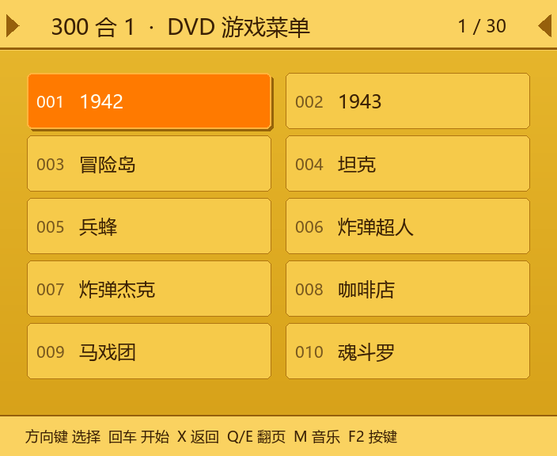
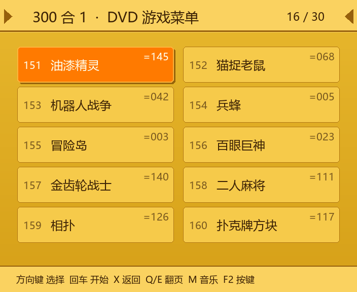
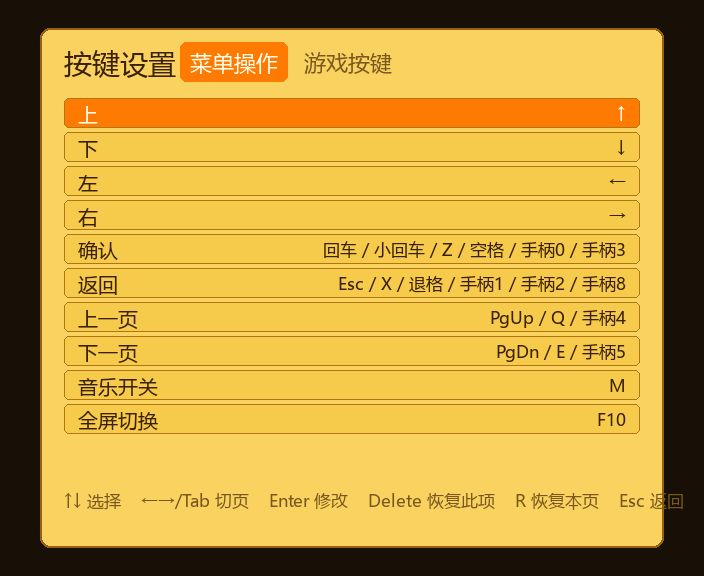

# retro-dvd-gameplay

<p align="center">
  <a href="README.md">English</a> · <a href="README.zh-CN.md">简体中文</a>
</p>

<p align="center">
  <a href="https://github.com/dncore/retro-dvd-gameplay/actions/workflows/tests.yml">
    
  </a>
</p>

<p align="center">
  
</p>

复刻 2005 年国产 DVD 播放器「300 合 1」NES 游戏碟的操作体验：土黄的菜单、有点跑调的
背景音乐，以及按下确认后那几百毫秒的读盘等待。

这不是硬件模拟器，而是给真实 NES 核心套上一层「当年的外壳」——用原盘的启动流程和片头，
配一个重建的菜单，再加一个进程内的 libretro 宿主。

## 功能

- 按原盘 **G001–G300 顺序**列出全部 **300 个条目**（去重后 146 款唯一游戏）
- **2×5 网格**、翻页、光标高亮；键盘与 SDL 手柄都可操作
- 启动时播放原盘 **22 秒开机动画**（`CDI_BUM.DAT`，运行时从你自己的镜像提取）
- 菜单循环播放原盘**背景音乐**
- **内置 libretro 宿主**（`rdvd/libretro.py`，`ctypes` 直调）：fceumm / Nestopia
  在同一个进程里跑，不需要装 RetroArch；退出自动存档
- **游戏音频**接进和菜单音乐同一个 `pygame.mixer`（16-bit 立体声，核心采样率不同时
  自动线性重采样）
- 找不到核心时可退回外部模拟器（RetroArch / FCEUX / Mesen / Nestopia）
- 无头渲染，可批量导出界面截图

## 截图

| 第 1 页 | 第 16 页 |
|---|---|
|  |  |

`=NNN` 角标表示这一条和前面某个序号指向同一份 ROM —— 原盘确实会把同一款游戏
挂在不同的菜单号下面。

## 快速开始（Windows）

```bat
git clone https://github.com/dncore/retro-dvd-gameplay.git
cd retro-dvd-gameplay
py -3 -m venv .venv
.venv\Scripts\activate
pip install -r requirements.txt

copy config.example.json config.json
notepad config.json
python run.py
```

把 `disc` 指向你自己的 `300nes_disc v1.iso`，`roms` 指向 NES ROM 目录。
Windows 用的两个核心 DLL（fceumm、Nestopia）已经在 `cores/` 里。

**ffmpeg 不是必需，但强烈建议装。** 它负责把盘里的片头和音乐转成可播放的格式；
没有 ffmpeg 游戏照样能跑，只是会跳过片头和菜单音乐。

### Linux / macOS

```bash
python3 -m venv .venv && . .venv/bin/activate
pip install -r requirements.txt
cp config.example.json config.json
# 把 libretro NES 核心放进 cores/（仓库里只有 Windows DLL）：
#   fceumm_libretro.so / fceumm_libretro.dylib
python run.py
```

## 打包 Windows 可执行文件

```powershell
powershell -ExecutionPolicy Bypass -File packaging\build.ps1 -InstallTools -Clean
powershell -ExecutionPolicy Bypass -File packaging\smoke_test.ps1
```

产物在 `dist\retro-dvd-gameplay\`。`config.json` 会复制到 exe 旁边，`data/` 和 `cores/`
则打进 `_internal\`。PyInstaller 和 Pillow 只在打包时需要，从源码运行不用装。

```bash
pip install -r requirements-dev.txt   # 测试、菜单页工具、打包
```

不启动界面、只检查构建是否正常：

```powershell
dist\retro-dvd-gameplay\retro-dvd-gameplay.exe --check
```

## 操作

### 菜单

| 动作 | 键盘 | 手柄 |
|---|---|---|
| 移动光标 | 方向键 | 十字键 / 左摇杆 |
| 启动游戏 | 回车 / Z / 空格 | A / Y |
| 返回（根目录按两次退出） | X / Esc | B / X / Select |
| 上一页 / 下一页 | Q / E、PgUp / PgDn | LB / RB |
| 背景音乐开关 | M | — |
| 全屏切换 | F10 | — |
| 按键设置 | F2 | — |
| 退出 | F12 | — |

### 游戏中

| 动作 | 键盘 | 手柄 |
|---|---|---|
| 十字键 | 方向键 | 十字键 / 左摇杆 |
| NES A | Z / J | A |
| NES B | X / K | B |
| Start | 回车 | Start |
| Select | 右 Shift | Y |
| 回菜单（自动存档） | Esc / F12 | Back |
| 存档 / 读档 | F5 / F7 | — |

### 按键设置

在菜单按 **F2** 打开按键设置。选中动作后按回车，再按下要绑定的键或手柄按钮即可。
`Delete` 恢复当前项，`R` 恢复整页，`Esc` 返回。绑定会写进 exe 旁边的 `config.json`。



手柄支持热插拔：随时插上或拔掉都可以。

## 配置

`config.json` 和 `run.py` 放在同一目录，**已被 git 忽略**——从
`config.example.json` 复制一份开始改。所有键都是可选的。

| 键 | 含义 |
|---|---|
| `disc` | 你的 `300nes_disc v1.iso` 路径，用于片头和音乐。 |
| `roms` | `data/catalog.json` 里相对路径所基于的 NES ROM 根目录。 |
| `bgm_dat` | 直接用已抽出的 `CDI_BUM.DAT`，不再读 ISO。 |
| `bgm_wav` | 背景音乐转码后的缓存路径。 |
| `boot` | 是否播放开机动画（默认 `true`）。 |
| `boot_cache` | 片头帧与音乐的缓存目录，默认 `~/.cache/retro-dvd-gameplay/boot`。 |
| `page_art_dir` | 已恢复的菜单页目录（`ITEM0001.png` …）。`null` = 用代码画的菜单。 |
| `play_mode` | `auto` / `core`（进程内）/ `external`。 |
| `core` | 显式指定 libretro NES 核心路径。 |
| `state_dir` | 存档目录。 |
| `emulator`、`args` | 外部模拟器命令与参数模板（`{rom}`、`{core}`）。 |
| `font` | 显式中文字体路径；不填则自动探测系统字体。 |
| `bindings` | 由 F2 界面维护的按键绑定。token 为 `key:<键码>` / `joy:<按钮号>`，也可以手改。 |

## 工作原理

```
你的 ISO
  ├── NEWROM/G001..G300.BIN  →  剥出 PRG/CHR，和你的 ROM 库比对
  ├── CDI_BUM.DAT            →  剥 MPEG-PS → ffmpeg → 499 帧片头 + 音乐
  └── SEGMENT/ITEM*.DAT      →  菜单页（只能部分恢复，见下）
```

- `tools/iso9660.py` 解析非标准镜像：2352 字节/扇区、Mode 2 Form 1、用户数据偏移 24。
- `tools/build_catalog.py` 用 PRG 多偏移哈希把每个 `GNNN.BIN` 对上 ROM，写出
  `data/catalog.json`。
- `tools/clean_titles.py` 去掉 No-Intro 的地区 / 版本 / 汉化组标签，让菜单名接近原盘观感。
- `rdvd/boot.py` 从 `CDI_BUM.DAT` 里剥 pack/PES 头，再交给 ffmpeg 出帧。
- `rdvd/libretro.py` 是一个极简的 libretro `ctypes` 前端。

完整的逆向笔记（包括所有失败尝试）在 [`docs/FORMAT.md`](docs/FORMAT.md)。

### 菜单原图问题

原盘菜单页是 704×576 的 MPEG-1 帧。每帧本应有 36 个切片，盘上只存了 32 个；
缺失的 18/25/27/35 会让画面右侧约 1/3 出现竖向拖影。已经穷举排除了 6 种解码参数组合、
分包错位、音频干扰，以及 VCD/EXT 下的 `PSD`/`LOT` 表——**缺失数据确实不在盘上**。
所以现在菜单是「版式忠实重建」，不是原图像素。细节见 `docs/FORMAT.md` §4。

### 导入恢复出来的原图

如果你拿到了原盘菜单页（录屏、真机截图），先规范成 `assets/pages/`，再把
`page_art_dir` 指过去：

```bash
pip install pillow
python tools/patch_pages.py shots/ --out assets/pages --crop 40,20,40,20 --size 704x576
```

工具会裁边、缩放到 704×576，可选把右侧预览图贴回去
（`--overlay`、`--overlay-at X,Y,W,H`），并写出 `manifest.json`。
`assets/pages/` 已被 git 忽略，光盘美术资源不会进入仓库。

## 已知限制

1. **菜单底图是重建版式，不是原图**（原因见上）。
2. **条目名来自 ROM 库**，不是 DVD 画面上的原文——盘上没有文本表，也没做 OCR。
3. 仓库里的核心是 Windows DLL，其他平台需要自备。
4. 光盘镜像和 ROM 需要你自己提供，仓库里不含。

## 数据与授权

本仓库**不包含** ISO、ROM 或提取出来的光盘画面。`data/catalog.json` 只保存用于匹配
你自己文件的文件名和元数据。片头、音乐和菜单图都在运行时从**你提供的**镜像里提取。

游戏、光盘及其美术资源归各自权利人所有。请只在你有权使用的素材上运行本项目。

## 第三方组件

`cores/` 里是预编译的 libretro 核心，遵循各自的许可：

- **FCEUmm** — GPL-2.0
- **Nestopia** — GPL-2.0

上游链接见 [`cores/README.md`](cores/README.md)。应用本身是 MIT 许可，运行时动态加载这些库。

## 许可

[MIT](LICENSE)。
